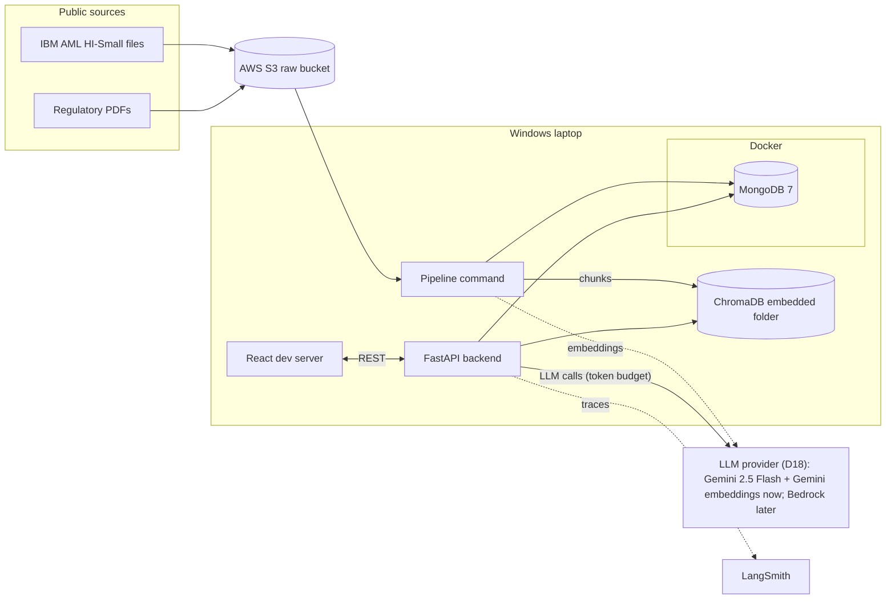
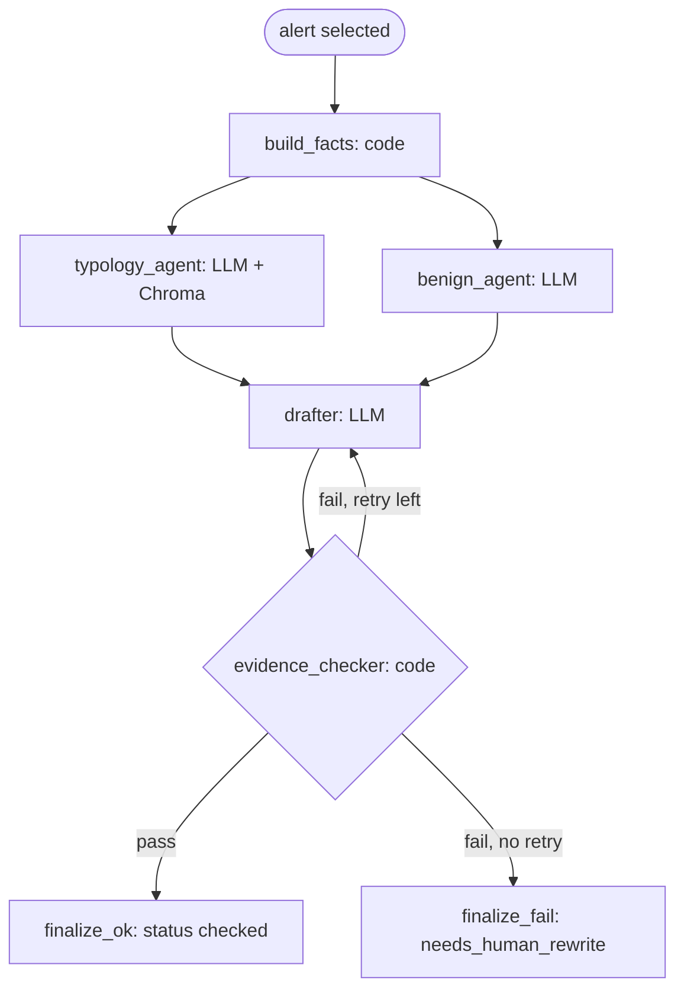

# CaseLens — Master Specification (prototype scale)

A small financial-crime compliance prototype with **one suspicious pattern**: the **fan pattern** (one account versus many different counterparties in a short time window), in two directions:
- **fan-out:** one sender pays many different receivers.
- **fan-in:** one receiver gets money from many different senders.

Modules: **Scenario Studio (mini)**, **Investigation Agents (mini)**, a human review screen.
Stack: React, FastAPI, MongoDB, ChromaDB, S3, Google Gemini API (now) or Amazon Bedrock (planned production path, D18), LangChain, LangGraph, LangSmith.
Constraints from the user: Windows laptop, 16 GB RAM, **disk under 10 GB**, **Bedrock spend $0 to $5 (free credits only)**, **small real data**, only MongoDB in Docker.

**Audience: Claude Code.** Read this file fully, then read the detail file for the milestone you are working on.

| File | Read it when |
|---|---|
| `PROJECT_REPORT.md` (this file) | Always |
| `docs/01_data_pipeline.md` | M1 |
| `docs/02_scenario_studio.md` | M2, M3 |
| `docs/03_investigation_agents.md` | M4 |
| `docs/04_api_and_frontend.md` | M3, M5 |
| `docs/05_evaluation_and_ops.md` | M6, and for tests, logging, security, cost |
| `reference/` | Tested code to copy first: models, checker, graph, token budget, rules oracle (20 tests) |
| `architecture.png` / `.svg` | The layered architecture picture |
| `CLAUDE.md` | Hard rules. Obey them |

---

## 1. Product in one page

**Business problem.** Banks must look for money laundering. Rules raise *alerts*. Two pains:
1. Most alerts are false alarms, yet an analyst must collect facts and write a *case file* for each.
2. Improving a rule takes months because the risk owner, analyst and model team keep clarifying it to each other.

**What we build (small).**
- **Scenario Studio:** plain-English worry → `ScenarioSpec` (direction out or in, plus numbers) → human approves → the fan rule runs on real labeled data → precision, pattern recall, real examples of hits and look-alike false alarms. Worries that are not the fan pattern are **rejected as unsupported**. This is deliberately not a universal pattern solver.
- **Investigation Agents:** for one alert, code builds a fact sheet → helpers add typology context and harmless explanations → a drafter writes a `CaseFile` → a code checker rejects unsupported claims → one retry → a human decides.
- **Human in the loop:** a React screen. AI only suggests.

**Primary quality goal.** Never mark a really suspicious alert as likely legitimate: the **false-clear rate**. Secondary: the **auto-clear rate**.

## 2. Scope and honesty

| Topic | Decision |
|---|---|
| Pattern | One: **fan** (`direction` = `out` or `in`). Nothing else is supported |
| Transactions | **IBM AML dataset**, HI-Small files only. Simulated by IBM from a multi-agent virtual world, labeled per transaction, with pattern files. License CDLA-Sharing-1.0 |
| Data size | A **small slice**: the first `SLICE_HOURS` (default 24) of the data, roughly 0.5 million transactions if the dataset's 10 days are evenly spread (an estimate; measure it) |
| Other real data | 3 to 5 public regulator guidance PDFs (FATF, FinCEN, FIU-IND or similar), chosen by the user |
| Fake data | None generated |
| Removed from earlier drafts | OFAC sanctions screening (dataset names are anonymized), Guardrails, MCP, the `cycle` rule, any second rule type, Knowledge Bases, SageMaker, agents platforms |
| Not in scope | Real customer data, compliance claims, authentication, multi-user, deployment, model training |
| Human decides | AI never closes a case |

Dataset facts from public sources (verify after download): about 515 thousand accounts and about 5.08 million transactions in all of HI-Small over about 10 days; about 0.1 percent laundering. Only **two files** are needed: `HI-Small_Trans.csv` (roughly 0.5 GB; a public mirror lists 476 MB) and `HI-Small_Patterns.txt`. The accounts file is not needed (entity names are anonymized and unused).

## 3. Glossary

| Term | Meaning here |
|---|---|
| Alert | One account in one time window that tripped the fan rule |
| Direction | `out` = one sender, many receivers. `in` = one receiver, many senders |
| Window | A fixed time bucket of `window_hours`, counted from `DATA_ORIGIN` (not rolling) |
| Case file | The structured report (`CaseFile`) for one alert |
| Fact | A number or list computed by code, with an id (`F0` to `F10`) |
| Claim | A sentence in the case file that must cite fact ids or document chunk ids |
| Checker | Plain code that verifies every claim. No LLM |
| Hit | An alert that contains at least one laundering-labeled transaction |
| Look-alike | An alert with no laundering-labeled transaction (a false alarm) |
| False-clear | A hit that the system marked `likely_legitimate`. Must be zero |
| Auto-clear | A look-alike marked `likely_legitimate` (time saved) |
| Pattern recall | Share of labeled pattern blocks of the matching type (`fan_out` or `fan_in`) that share a transaction with some alert |
| Leakage | Labels reaching the AI. Forbidden |

## 4. Architecture

Picture: `architecture.png`.





Reference-diagram mapping: Snowflake Raw/Staging/Intermediate/Marts → S3 `raw/` → MongoDB `stg_*` → MongoDB result collections. Airflow/dbt → one Python pipeline command. Ollama → Bedrock. Power Apps → React review screen. Claim systems simulator → `POST /api/mock-case-system/cases`. Observability/QA/governance bands → `docs/05`.

## 5. Decision log (do not change without updating this file)

| # | Decision | Reason | Rejected |
|---|---|---|---|
| D1 | IBM AML HI-Small, a time slice of `SLICE_HOURS` | Labeled, public, has pattern files; small | Whole dataset, larger variants |
| D2 | **One pattern family (fan), direction out or in**, one rule function | User wants focus; fewer moving parts | Several templates, rule generation |
| D3 | Layers: raw (S3) → staging (`stg_*`) → result collections | Matches the reference idea, small | Four layers, Airflow, dbt |
| D4 | Sync `pymongo`, sync FastAPI endpoints, `BackgroundTasks` | Simple | Motor/async |
| D5 | Fixed time buckets from `DATA_ORIGIN` using plain arithmetic | Identical in Mongo and pandas | `$dateTrunc`, rolling windows |
| D6 | LLM fills Pydantic schemas only | Safety, testability | LLM writing queries |
| D7 | All numbers computed by code; LLM cites fact ids | LLM can invent numbers | LLM arithmetic |
| D8 | Checker is plain code | Strict, predictable | LLM judge as main control |
| D9 | Fixed LangGraph, parallel pair, join, one retry | Predictable cost | Free-roaming agent |
| D10 | LangSmith is the only tracing/evaluation tool (can be switched off) | One tool | CloudWatch |
| D11 | One small chat model on Bedrock, **GPT-OSS 20B in-region in `ap-south-1`**, plus Titan Text Embeddings v2; **token ledger with hard budget** (cumulative: loaded from `llm_usage` at start; no AI call if the store cannot be read) | Free-credit budget. Changed 2026-11-12 from "one small Claude model": the user chose `ap-south-1`, where no Claude or Nova model runs in-region; GPT-OSS 20B does, so no cross-Region inference profile is needed. Structured output (tool use) must be proven by `bedrock_smoke` | Several models, strong drafter; Claude Haiku or Nova via APAC cross-Region profile; switching Region |
| D12 | Ground truth only in evaluation-only collections (`stg_labels`, `stg_pattern_blocks`, `alert_truth`) | Prevent leakage | Labels on transactions or alerts |
| D13 | Decisions: `dismiss`, `escalate`, `need_info` | Clear meaning | "approve" |
| D14 | **Chroma embedded** (`PersistentClient` / `persist_directory`, folder `data/chroma`) | No extra container; tiny data | Chroma server |
| D15 | **Only MongoDB runs in Docker**; FastAPI, pipeline and React run directly on Windows | User choice; lighter | Docker for everything |
| D16 | Small test sets: 20 intents, 10 dev alerts, 30 eval alerts | Cost | Large evaluations |
| D17 | **Upload of new transaction files (M7)**, appended to staging; scenarios can run on a **date range** and on **new data only**. Added 2026-11-12 at the user's request | The user has no live feed; without uploads the app cannot show "new data arrives → new alerts". Date ranges let a risk owner design a rule on one period and validate it on an unseen period. Costs no extra AWS services and no AI tokens | Live streaming API; replacing data on each upload; "a scenario runs once" (now: one full run, then further runs on a range or on new data) |
| D18 | **Model provider switch; Google Gemini API used now, Bedrock kept as the production path.** `LLM_PROVIDER=gemini` uses `gemini-2.5-flash` (thinking budget 0) and `gemini-embedding-001` at 512 dimensions, L2-normalized; `LLM_PROVIDER=bedrock` uses D11 unchanged. Every call still goes through the token ledger, temperature 0, capped output and the per-case call limit; a client-side rate limit (`LLM_REQUESTS_PER_MINUTE`) respects free-tier quotas. Added 2026-11-17 at the user's request | On the user's account (free plan, verification pending) every Bedrock call, including Amazon's own Titan, returned `ValidationException: Operation not allowed` for three days; support cases stayed unassigned. The free Gemini tier needs no card and covers chat and embeddings with one key. Data sent is simulated public data plus public regulator text; Google may use free-tier inputs to improve its models | Waiting for AWS; a local model via Ollama (about 6 GB of disk, weaker schema filling); paid APIs |

## 6. Tech stack and tested versions

Backend (Python 3.11 or 3.12): `fastapi`, `uvicorn[standard]`, `pydantic>=2`, `pydantic-settings`, `pymongo`, `boto3`, `langchain-aws`, `langchain-core`, `langchain-chroma`, `chromadb`, `langgraph`, `langsmith`, `pypdf`, `pandas`, `structlog`, `httpx`; dev: `pytest`, `ruff`. The `kaggle` CLI is used once to download files.

Reference code tested with: pydantic 2.14, langgraph 1.2.x, langchain-aws 1.9.x, langchain-chroma 1.1.x, chromadb 1.5.x, langchain-core 1.7.x, langsmith 0.14.x.

Verified (by installing the packages): `ChatBedrockConverse(model=..., region_name=..., credentials_profile_name=..., temperature=0, max_tokens=...)` and `.with_structured_output(Model)` construct without AWS calls; `BedrockEmbeddings(model_id="amazon.titan-embed-text-v2:0", region_name=...)`; Chroma embedded persistence with `Chroma(collection_name=..., embedding_function=..., persist_directory=...)`, reopen from disk, `delete(where=...)`, `similarity_search_with_score(query, k, filter=...)`; `langsmith.Client.evaluate(target, data=, evaluators=, summary_evaluators=, experiment_prefix=, metadata=, max_concurrency=)`; LangGraph join `add_edge(["typology_agent", "benign_agent"], "drafter")`; the token budget callback in `reference/budget.py`.

Frontend: Vite, React 18, TypeScript, `react-router-dom`, `@tanstack/react-query`, plain CSS.

## 7. Windows setup (M0)

The user's laptop is Windows, nothing is configured yet. Use **PowerShell**. Keep all project code cross-platform (use `pathlib`, no shell-specific scripts; Python commands for anything operational).

1. **Install:** Git, Python 3.12 (python.org installer; this laptop also has Anaconda 3.13, which is not used), Node.js current LTS (26 on this laptop; 20 is end-of-life), AWS CLI v2, Docker Desktop (WSL2 backend; virtualization must be enabled in BIOS/UEFI; follow Docker's current Windows instructions).
2. **Limit Docker's memory** by creating `%UserProfile%\.wslconfig`:
   ```
   [wsl2]
   memory=4GB
   processors=4
   ```
   then run `wsl --shutdown` and restart Docker Desktop.
3. **Check Docker:** `docker version` and `docker run --rm hello-world`.
4. **Python environment:**
   ```
   & "$env:LocalAppData\Programs\Python\Python312\python.exe" -m venv .venv   # no `py` launcher on this laptop
   .\.venv\Scripts\Activate.ps1          # if blocked: Set-ExecutionPolicy -Scope CurrentUser RemoteSigned
   pip install --no-cache-dir -e "backend[dev]"   # no pip cache: no second copy of dependencies
   cd backend; pytest -q                 # pytest config lives in backend\pyproject.toml
   ```
5. **Frontend:** `cd frontend; npm install; npm run dev` (port 5173).
6. **AWS:** `aws configure sso` (preferred) or `aws configure` with an IAM user limited to the policy in `docs/05`; check with `aws sts get-caller-identity`. boto3 reads `%UserProfile%\.aws` automatically. Enable the chosen Bedrock models in the console (model access) in your Region.
7. **Kaggle:** create an API token in the Kaggle account settings and place it as Kaggle's current instructions say (check). Never commit it.
8. **MongoDB:** `docker compose up -d mongo`.
9. **Smoke tests:** `python -m app.scripts.bedrock_smoke` (one chat reply, one embedding length, token usage) and `curl http://localhost:8000/api/health` (use `curl.exe` in PowerShell).

Windows pitfalls: Windows Defender can slow large file reads (be patient or exclude `data/` if the user agrees); do not put the project under a path with spaces or very long names; line endings do not matter for the CSV; run `uvicorn app.main:app --reload --port 8000` from the `backend` folder; if a port is busy, change it in `.env`.

## 8. Repository layout

```
caselens/
  CLAUDE.md
  PROJECT_REPORT.md
  docs/                        # the five detail files
  reference/                   # tested code to copy
  architecture.png
  docker-compose.yml           # MongoDB only
  .env.example
  .gitignore                   # .env, data/, .venv/, node_modules/, __pycache__/
  data/                        # downloads and Chroma folder; gitignored
  backend/
    pyproject.toml
    app/
      main.py                  # FastAPI app, routers, CORS, request-id middleware
      config.py                # pydantic-settings; the only place that reads env
      logging.py
      llm.py                   # get_chat_model(), get_embeddings(), shared TokenLedger + BudgetCallback
      budget.py                # from reference/budget.py
      db.py                    # mongo client, getters, ensure_indexes()
      models/                  # scenario.py, case.py, api.py (from reference/models.py)
      rules/                   # fan.py (query builder), engine.py, metrics.py
      scenario/                # parse.py, prompts.py, service.py
      investigation/           # facts.py, nodes.py, prompts.py, checker.py, graph.py, service.py, triage_baseline.py
      tools/                   # read-only data access (allow-listed)
      api/                     # health.py, scenarios.py, alerts.py, cases.py, mock_case_system.py
      eval/                    # data/*.jsonl, evaluators.py, run_scenario_eval.py, run_case_eval.py
      scripts/                 # bedrock_smoke.py, make_dev_split.py, estimate_cost.py
    pipeline/                  # run.py, slice_advice.py, load_raw.py, stage.py, labels.py, ingest_docs.py, dq.py, disk_report.py
    tests/                     # oracle.py (from reference), test_*.py
  frontend/
    package.json
    src/ (main.tsx, App.tsx, api/, pages/, components/)
```

## 9. Configuration

Read only in `backend/app/config.py`.

| Variable | Default | Meaning |
|---|---|---|
| `LLM_PROVIDER` | `gemini` | `gemini` or `bedrock` (D18) |
| `GEMINI_API_KEY`, `GEMINI_LLM_ID`, `GEMINI_EMBED_ID`, `GEMINI_THINKING_BUDGET` | none, `gemini-2.5-flash`, `gemini-embedding-001`, `0` | Gemini provider |
| `LLM_REQUESTS_PER_MINUTE` | `0` (none) | Client-side rate limit for chat calls |
| `AWS_REGION`, `AWS_PROFILE` | none | Bedrock and S3 |
| `S3_BUCKET` | none | Raw bucket |
| `BEDROCK_LLM_ID` | none | **One** small chat model id (pick from your console; check Region availability) |
| `BEDROCK_EMBED_ID` | `amazon.titan-embed-text-v2:0` | Embeddings |
| `EMBED_DIMENSIONS` | `512` | Smaller vectors are enough for a few thousand chunks (Titan v2 supports several sizes; check). Never change after ingestion |
| `LLM_MAX_TOKENS` | `1000` | Output cap per call |
| `LLM_TEMPERATURE` | `0` | |
| `LLM_TOKEN_BUDGET_INPUT` | `1500000` | Hard stop for total input tokens (see section 11) |
| `LLM_TOKEN_BUDGET_OUTPUT` | `300000` | Hard stop for total output tokens |
| `EMBED_TOKEN_BUDGET` | `400000` | Hard stop for total embedding tokens |
| `MAX_LLM_CALLS_PER_CASE` | `6` | Circuit breaker per investigation |
| `LLM_EXTRA_REQUEST_FIELDS` | empty | Optional JSON passed to Bedrock as `additionalModelRequestFields` (only if the smoke test shows the model needs it) |
| `API_BASE_URL` | `http://localhost:8000` | The backend forwards decisions to its own mock case system route here |
| `CORS_ORIGINS` | `http://localhost:5173` | Comma-separated origins allowed to call the API (change both ports if 8000/5173 are taken) |
| `MONGO_URI` | `mongodb://localhost:27017/caselens` | Docker maps the port to the laptop |
| `CHROMA_PATH` | `data/chroma` | Embedded Chroma folder |
| `CHROMA_COLLECTION` | `reg_docs` | |
| `LANGSMITH_TRACING`, `LANGSMITH_API_KEY`, `LANGSMITH_PROJECT` | `true`, none, `caselens` | Set tracing to `false` to run without LangSmith |
| `SLICE_HOURS` | `24` | Keep only transactions in the first N hours from `DATA_ORIGIN` (see `slice_advice`) |
| `MAX_ROWS` | empty | Optional cap on rows read |
| `KEEP_LOCAL_RAW` | `false` | Delete local raw files after staging and labels succeed |
| `MONGO_MAX_GB` | `1` | Staging stops if the database exceeds this |
| `DISK_BUDGET_GB` | `10` | Used by the disk report |
| `MAX_ALERTS` | `5000` | A scenario that makes more alerts fails with `too_many_alerts` |
| `TYPOLOGY_TOP_K` | `4` | Chroma results |
| `PROMPT_VERSION` | `v1` | Stored on every case |
| `RANDOM_SEED` | `42` | |
| `ID_PATTERN` | `\b[0-9A-F]{8,12}\b` | Account-id shape for the checker; adjust after inspecting the data |

`.env.example` lists every variable with empty or default values. Never commit `.env`.

## 10. Docker (MongoDB only)

`docker-compose.yml`:

```yaml
services:
  mongo:
    image: mongo:7
    command: ["mongod", "--wiredTigerCacheSizeGB", "1"]
    mem_limit: 2g
    ports: ["27017:27017"]
    volumes: ["mongo_data:/data/db"]
    healthcheck:
      test: ["CMD", "mongosh", "--quiet", "--eval", "db.adminCommand('ping').ok"]
      interval: 10s
      timeout: 5s
      retries: 6
volumes: { mongo_data: {} }
```

Commands: `docker compose up -d mongo`, `docker compose stop mongo`, `docker compose down -v` (also deletes the data volume).

## 11. Cost and resource budget

### 11.1 Money: Bedrock $0 to $5, free credits only
- New AWS accounts may receive free-plan credits that can cover Bedrock (checked in November 2026; confirm in the Billing console under Credits, because accounts that already had an AWS account may not qualify). Set a budget alert on day one. Budget alerts warn; they do not stop spending.
- **The code enforces a token budget.** `reference/budget.py` provides `TokenLedger` and `BudgetCallback`. Every LLM call carries the callback. Usage is read from the model response and each call is stored in `llm_usage` (`input_tokens`, `output_tokens`, `node`, `alert_id`, `ts`). When the budget is used up, calls raise `TokenBudgetExceeded` and the API returns `llm_budget_exhausted`. Embedding calls are counted the same way against `EMBED_TOKEN_BUDGET` (estimate tokens as characters divided by 4 if the response has no usage).
- Rough token estimates (**mine, not measured**): one investigation = typology about 2k in / 0.3k out + benign about 2k in / 0.4k out + drafter about 3.5k in / 0.8k out, about 7.5k in / 1.5k out; a retry adds about 4k in / 0.8k out. One scenario parse about 0.6k in / 0.2k out. Embedding 3 to 5 PDFs once is roughly 0.1 to 0.2 million tokens. With about 120 investigations during development (3 dev passes plus final runs), that is on the order of 1 million input and 0.2 million output tokens. The default budgets above are set slightly higher.
- `python -m app.scripts.estimate_cost --price-in <USD per million input tokens> --price-out <USD per million output tokens>` reads `llm_usage` and prints the spend so far. **Look up the current price of your chosen model yourself**; this spec does not state prices.
- Savings built in: one small model, `temperature 0`, `max_tokens` cap, one retry, investigate 3 to 5 alerts before running 30, embed PDFs once, tiny data, small test sets.
- LangSmith: check the free plan limits before relying on it. With `LANGSMITH_TRACING=false` everything still works; metrics are then computed by the local scripts from the `cases` and `llm_usage` collections.

### 11.2 Disk (under 10 GB) and RAM (16 GB)
Estimates are **mine, not measured**. Measure with `python -m pipeline.disk_report` and record real numbers in `docs/DATA_NOTES.md`.

| Item | Estimate | Note |
|---|---|---|
| Raw data (two HI-Small files) | about 0.5 GB | deleted after staging unless `KEEP_LOCAL_RAW=true`; S3 keeps the originals |
| MongoDB data, 24-hour slice with indexes | about 0.2 to 0.6 GB | guard at `MONGO_MAX_GB=1` |
| MongoDB image | about 0.8 GB | |
| Chroma folder | under 0.1 GB | 3 to 5 PDFs |
| Python virtualenv | about 2 GB | |
| `node_modules` | about 0.5 GB | |
| Docker Desktop itself (app + WSL2 virtual disk) | **several GB; not counted above** | The user must decide whether the 10 GB cap includes installed tools. If disk gets tight, switch MongoDB to a native Windows install by changing only `MONGO_URI` |

Docker Desktop's WSL2 disk file can grow and may not shrink by itself (check Docker's docs). RAM: Mongo cache 1 GB, container 2 GB, WSL2 capped at 4 GB, the loader reads in 100,000-row chunks, so 16 GB is plenty.

## 12. Conventions

- Time is UTC. Mongo stores `datetime`. The API sends ISO 8601 strings. JSON keys are `snake_case`.
- `alert_id` = first 16 hex characters of `sha1(f"{scenario_id}|{account_id}|{direction}|{window_start_iso}")`. `case_id`, `scenario_id` = `uuid4().hex`.
- API errors: `{"error": {"code": "...", "message": "...", "details": {}}}`.
- Logging: `structlog` JSON to the console; never secrets, full prompts or full documents.
- Bedrock: boto3 `Config(retries={"max_attempts": 5, "mode": "adaptive"})`, read timeout 60 s; structured-output parse failure → retry once, then fail the step.
- Every LLM call: temperature 0, `max_tokens` from config, tags `["caselens", node]`, metadata `alert_id`, `scenario_id`, `prompt_version`, and the `BudgetCallback`.
- Background jobs: FastAPI `BackgroundTasks`; each job writes `status` and `error` to its own document; the UI polls.

State machines:

| Object | States |
|---|---|
| `scenarios.status` | `draft` → `approved` → `running` → `completed` or `failed`; `draft` → `rejected` |
| `rule_runs.status` | `running` → `completed` or `failed` |
| `alerts.status` | `new` → `investigating` → `reviewed` |
| `cases.status` | `queued` → `running` → `checked` or `needs_human_rewrite` or `failed` → `decided` |
| decision | `dismiss` (close as false alarm), `escalate`, `need_info` |

## 13. Milestones with acceptance checks

Stop at **M6**, then M7 (added by the user, D17).

| M | Deliverable | Acceptance (all must pass) |
|---|---|---|
| **M0 Setup** | Windows tools installed, repo, `.env`, MongoDB container, S3 bucket (public access blocked, encryption on), IAM policy, smoke tests, two HI-Small files downloaded and uploaded | `docker compose up -d mongo` healthy; `bedrock_smoke` prints a reply, an embedding length and token usage; `aws s3 ls s3://<bucket>/raw/` shows the files; only the two HI-Small files were downloaded; `pytest -q` passes the reference tests |
| **M1 Data** | `slice_advice`, `pipeline.run` steps `raw`, `staging`, `labels`, `docs`, `dq` | `slice_advice` run first and a `SLICE_HOURS` chosen; re-running a step changes nothing; staging counts equal raw counts in the slice minus logged rejects; `dq_reports` has no failed check; `stg_transactions` has **no** label field; `disk_report` is well under the budget |
| **M2 Fan rule** | One rule function, alert writer, truth, metrics | Mongo results equal the pandas oracle on fixtures; on the real slice a run prints alert count, precision and pattern recall for direction `out` and for direction `in`; `alerts` documents contain no label field |
| **M3 Scenario Studio** | Parse chain, validation, approve, run, results, eval set 1 (20 intents) | Unsupported worries return `direction: null` with a reason; invalid numbers rejected; `llm_usage` rows written; LangSmith experiment (or local report) with the metrics from `docs/05` |
| **M4 Investigation** | Facts, tools, Chroma ingestion, 3 LLM nodes, checker, graph, leakage tests | 5 alerts run from the command line; each case ends `checked` or `needs_human_rewrite`; leakage tests pass; token ledger shows usage |
| **M5 UI** | React: Scenario Studio, Alert queue, Case review, mock case system | In the browser: type a worry → approve → run → open an alert → investigate → see claims with evidence chips → decide; the decision is in `decisions` and in the mock case system |
| **M6 Evaluation** | Eval set 2 (10 dev + 30 eval alerts), baselines, README | Results table with measured numbers, three systems compared, failures listed, cost summary from `llm_usage` |
| **M7 Upload (D17)** | Data page: upload a CSV in the IBM transaction format (optional patterns file), validation report, append, run approved scenarios on new windows; scenario runs on a date range | Re-uploading the same file adds 0 rows; rows before the data origin are rejected; new alerts never duplicate old ones; uploaded labels go only to evaluation-only collections; a rule designed on day 1 can be validated on day 2 in the UI |

## 14. Definition of done

1. A fresh clone plus `.env` runs with the README steps on Windows.
2. M0 to M6 acceptance checks pass.
3. README: problem, picture, how to run, data sources and licenses, measured results, failures, limits, cost summary, cleanup.
4. No secrets in git. No label leakage. Tests pass. Total spend within the budget.

## 15. Known pitfalls (check early)

1. `Trans.csv` has **two columns both named `Account`**. Read with explicit `names=[...]` and `header=0`.
2. Check whether `Account` is unique across banks; if not, use `f"{bank}|{account}"` everywhere. Record in `docs/DATA_NOTES.md`.
3. Timestamp format is expected to be `YYYY/MM/DD HH:MM`; verify; parse as UTC.
4. Patterns file lines map to transactions by a row key (see `docs/01`); duplicates are possible.
5. The slice may contain few complete fan pattern blocks. Run `slice_advice` before loading and raise `SLICE_HOURS` only if needed.
6. Sum amounts per currency only.
7. `allowDiskUse=True` on the aggregation, but the slice is small, so temporary disk use should stay small.
8. A Bedrock model id may be unavailable in your Region or need model access enabled (check). Use the smoke script first.
9. Windows: PowerShell execution policy can block venv activation; Docker needs virtualization enabled.
10. LangSmith limits and Bedrock credits can change; check them.

## 16. Assumptions and open questions

Assumptions: "fan-out and fan-in" means **one pattern family with two directions** (the user answered both options when asked for one pattern); sanctions screening and OFAC data are dropped; the first 24 hours of HI-Small is a good starting slice; one small Bedrock model is enough.
Answered by the user: has a Kaggle account; 16 GB RAM; disk under 10 GB; Windows, nothing configured; Docker only for MongoDB; Bedrock budget $0 to $5 from free credits; wants a small real-data prototype with one pattern.
Answered on 2026-11-11/12:
- Region `ap-south-1`. Chat model **GPT-OSS 20B** (in-region; see D11), later Qwen3 Next 80B. Embeddings Titan Text Embeddings v2 (in-region).
- 2026-11-17: Bedrock blocked on the account (verification pending). The user chose to proceed with another provider and keep Bedrock as a future addition (D18).
- The 10 GB cap covers **project artifacts only** (venv, `node_modules`, `data/`, Chroma, MongoDB image and volume), not Docker Desktop, WSL2 or installed tools.
- Python 3.12 (python.org) for the venv; Node.js current LTS; the repo is a git repo in `caseLens`.
- LangSmith tracing is on (the user has a key).
- PDFs: Claude proposes 3 to 5 public FATF / FinCEN / FIU-IND documents; the user approves before the M1 `docs` step.

Spec fixes made at M0: the `dq` raw check compares the S3 object's SHA-256 metadata with the checksum recorded by the `raw` step (local files are deleted when `KEEP_LOCAL_RAW=false`); `docs/03` §8 uses the §5 names (`calls`, `CallLimitExceeded`, `TokenBudgetExceeded`); `docs/05` section references corrected. Known issue for M4: the checker's id pattern also matches plain 8 to 12 digit numbers, but compares them only against string fact values, so a correctly copied large amount written without commas would be rejected.

Still open: which AWS profile to use; GPT-OSS 20B price in `ap-south-1` and whether free credits cover it (user checks); the exact PDF list.
