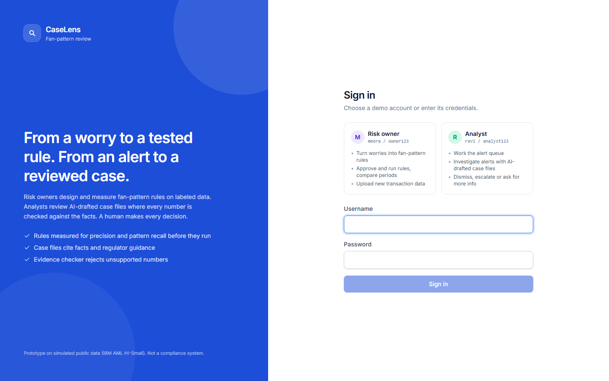
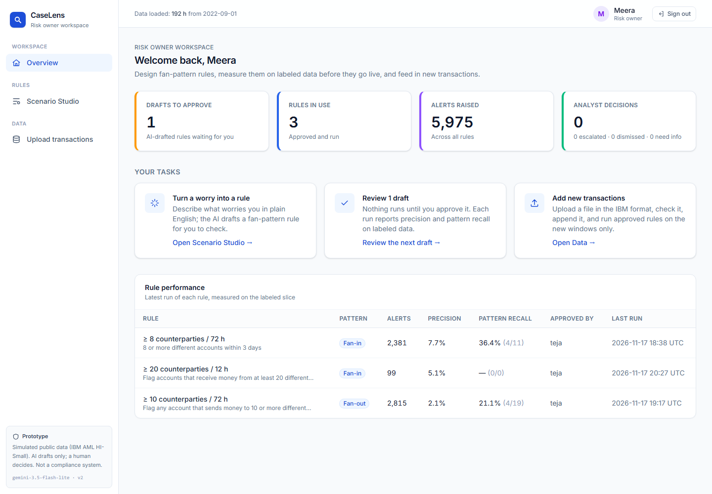
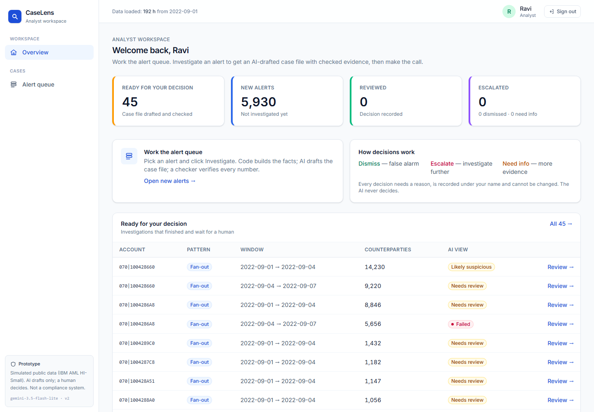
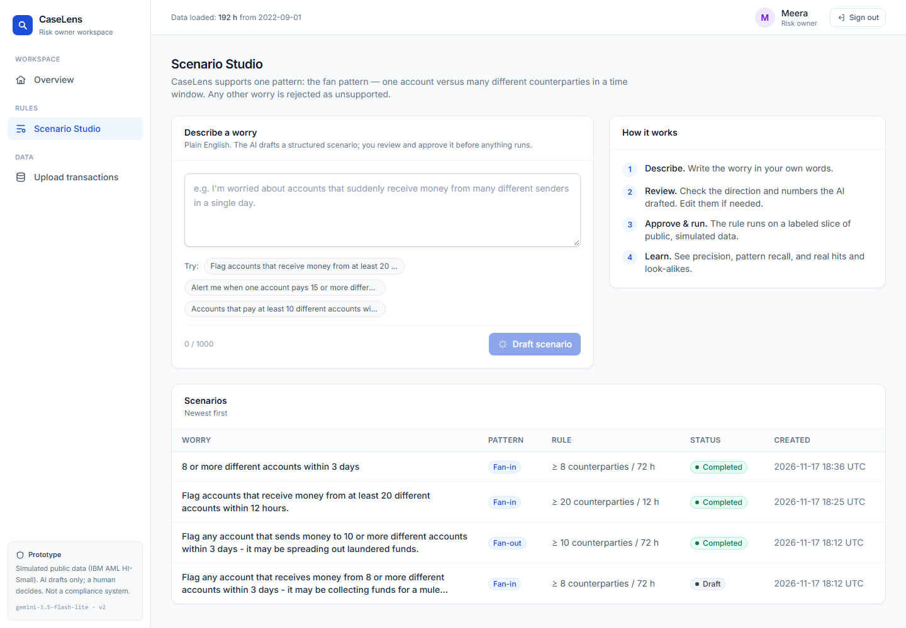
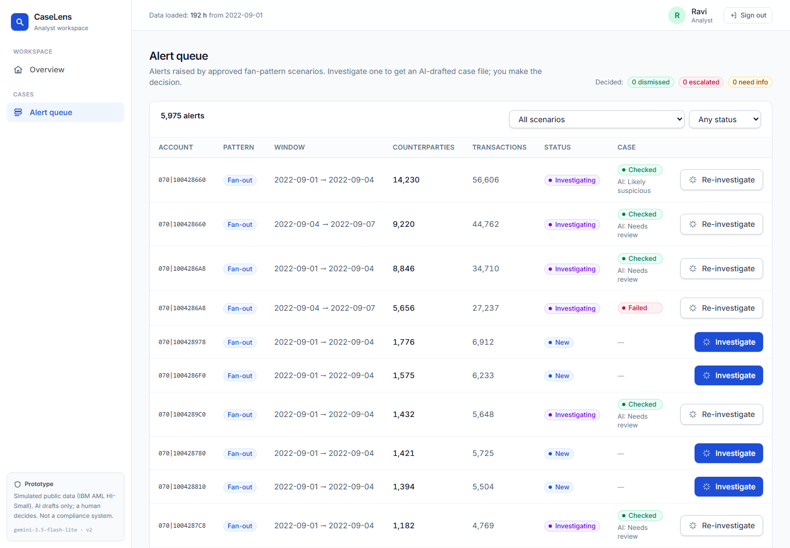
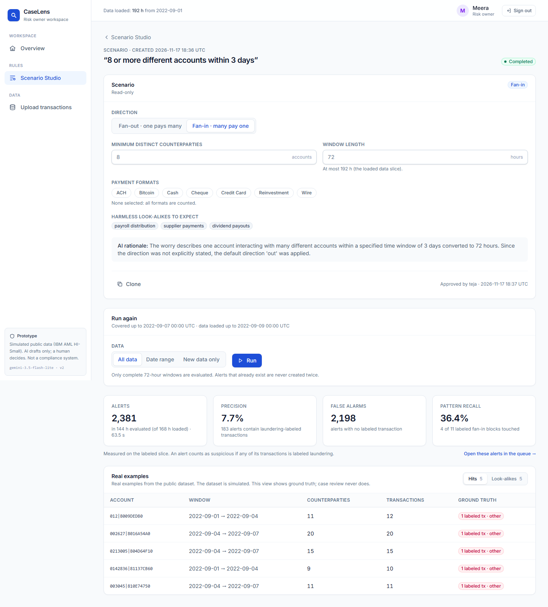
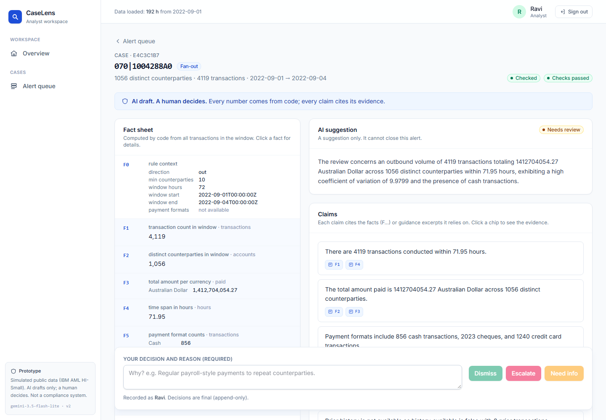
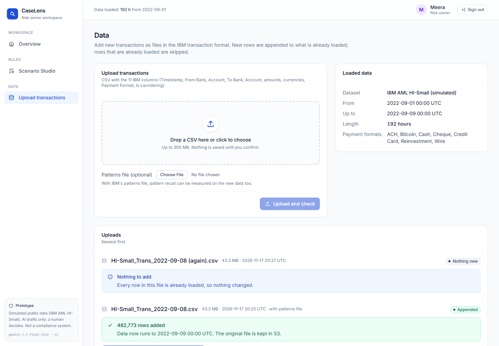

# CaseLens

**An AI-assisted review tool for one money-laundering pattern, built end to end on real (simulated) bank data.**

A risk owner describes a worry in plain English; an LLM turns it into a rule; the rule is measured on labeled data
before anyone relies on it. An analyst opens an alert; code collects the facts, AI agents draft a case file with cited
evidence and regulator guidance, a code checker rejects any unsupported number, and the analyst decides.

> **Prototype on simulated public data (IBM AML HI-Small). Not a compliance system.** The AI drafts; a human decides.



## Highlights

- **Two role-based workspaces** with server-enforced permissions: a risk owner designs and runs rules, an analyst
  investigates and decides.
- **Worry → rule in seconds:** 20 of 20 test worries parsed correctly, including 8 of 8 unsupported ones rejected.
- **Measured before trusted:** every rule run reports precision and pattern recall on 4.2 M labeled transactions.
- **Grounded case files:** the LLM only fills schemas; every number comes from a code-built fact sheet, every claim
  cites fact ids or regulator excerpts (RAG over FinCEN, FFIEC and FATF documents), and a plain-code checker verifies them.
- **Safety first:** 0 of 15 truly suspicious alerts were marked "likely legitimate" in the held-out evaluation.
- **Cost control in code:** a persistent token ledger with hard budgets, call caps per case, dry-run estimates and rate
  limits. Total AI spend for the whole project: **$0** (Gemini free tier).
- **New data by upload:** all-or-nothing appends with de-duplication; approved rules run on the new windows only.
- **127 automated tests**, including label-leakage tests that prove ground truth never reaches the AI.

## Screenshots

| Risk owner | Analyst |
|---|---|
|  |  |
| **Overview:** drafts to approve, rule performance | **Overview:** cases waiting for a decision |
|  |  |
| **Scenario Studio:** describe a worry, the AI drafts a rule | **Alert queue:** investigate an alert |
|  |  |
| **Rule results:** precision, recall, real examples | **Case file:** fact sheet, cited claims, decision bar |
|  | |
| **Data:** upload, validate, append new transactions | |

A step-by-step demo script is in [docs/WALKTHROUGH.md](docs/WALKTHROUGH.md).

## The problem

Banks run rules that raise money-laundering alerts, and two things hurt:

1. **Most alerts are false alarms**, yet an analyst must collect facts and write a case file for each one.
2. **Improving a rule is slow**, because the risk owner, the analysts and the model team keep re-explaining it to
   each other, and nobody measures a rule before it goes live.

CaseLens takes one well-defined pattern, the **fan pattern** (one account paying many different accounts, *fan-out*,
or receiving from many, *fan-in*, within a time window), and builds both halves of the workflow around it.

## How it works

```
IBM HI-Small (2 files) ─┐                          ┌─ Scenario Studio ── fan rule (Mongo aggregation) ── metrics
Regulator PDFs (3) ─────┴─► S3 raw/ ─► pipeline ─► MongoDB stg_* ─┤
                                          └─► Chroma (embedded)    └─ Investigation graph (LangGraph)
                                                                       build_facts (code)
                                                                       ├─ typology_agent (LLM + RAG)
                                                                       └─ benign_agent (LLM)
                                                                       drafter (LLM) → evidence_checker (code)
                                                                       → one retry → human decision (React)
```


**Scenario Studio (risk owner).** A worry such as *"accounts receiving from 8 or more different accounts within 3
days"* goes to the LLM, which can only fill a closed `ScenarioSpec` schema (direction plus two numbers) or reject the
worry as unsupported. The owner reviews and approves; the rule runs as a MongoDB aggregation over fixed windows and
reports alert count, precision, pattern recall, real hits and harmless look-alikes. Rules can be re-run on a date range
or on newly uploaded data only.

**Investigation (analyst).** For one alert, code builds a fact sheet (F0–F10: counts, amounts, timing, history,
counterparty and bank diversity, amount regularity). Two agents run in parallel: one retrieves matching red flags from
the regulator PDFs, the other proposes harmless explanations supported by facts. A drafter writes the case file; a
plain-code checker verifies every id and number against the cited facts (one retry). The analyst records a decision —
dismiss, escalate or need more info — which is append-only and forwarded to a mock downstream case system.

## Results

Measured on the 168-hour slice of IBM HI-Small (3.7 M transactions; 24 fan-out and 16 fan-in labeled patterns) with
Gemini 3.5 Flash-Lite. Full tables: [docs/results/](docs/results/). Each configuration was run once.

**Rules on real data**

| Rule (approved by a human) | Alerts | Precision | Patterns caught |
|---|---|---|---|
| Fan-in, ≥ 20 counterparties in 12 h | 680 | 8.1 % | **0 / 16** |
| Fan-in, ≥ 8 counterparties in 72 h | 2,381 | 7.7 % | 4 / 11 |
| Fan-out, ≥ 10 counterparties in 72 h | 2,815 | 2.1 % | 4 / 19 |

IBM's fan patterns are "low and slow" (median 7–8 payments spread over 3–4 days), so a plausible short-window rule
caught none of them. That is exactly what the Studio is for: finding out before a rule goes live.

**Worry → rule (20 worries):** 20/20 valid schemas, 20/20 correct direction, 12/12 numbers in range, 8/8 unsupported
worries rejected, 7.8 s each.

**Case files (30 held-out alerts, 15 suspicious / 15 not)**

| System | False-clear | Auto-clear | Review load | Checker passed | Latency | Tokens in/out |
|---|---|---|---|---|---|---|
| A. Rule only | 0 % | 0 % | 100 % | — | — | — |
| B. Code baseline (tuned on dev) | 0 % | 0 % | 100 % | — | — | — |
| C. CaseLens | **0 %** | 0 % | 100 % | 96.7 % | 26 s | 3,071 / 846 |

**Honest reading:** CaseLens met the safety goal and every claim was supported by cited facts (citation validity
100 %), but it **did not reduce the review load** — it sent every alert to a human, as did the code baseline. On this
data its value is a drafted, evidence-checked case file in about 26 seconds, not automatic triage. Thirty alerts give a
coarse estimate.

**Failures that changed the system**

1. **A false clear in development.** Prompt v1 called an alert with 650 cash payments and wildly irregular amounts
   "likely legitimate". Prompt v2 lists five concrete red flags tied to fact ids; any one forbids a clear. The dev
   false-clear rate went from 1/5 to 0/5 before the final evaluation was run once.
2. **A sensible-sounding rule caught nothing** (above), because fixed short windows cannot see slow patterns.
3. **Provider overload.** One evaluation case failed on Google's `503 high demand` and counted as "needs review".
4. **An upload left half a file behind.** The database size guard stopped a 482k-row append midway. Appends are now
   all-or-nothing, with a conservative size check and rollback (test added).

More detail in [docs/DATA_NOTES.md](docs/DATA_NOTES.md) and [PROJECT_REPORT.md](PROJECT_REPORT.md).

## Tech stack

| Layer | Technology |
|---|---|
| Frontend | React 18, TypeScript, Vite, Tailwind CSS 4, TanStack Query, React Router |
| API | FastAPI, Pydantic v2, pydantic-settings, structlog |
| AI orchestration | LangChain (structured output), LangGraph (fixed graph with a parallel branch), LangSmith (tracing, evaluation) |
| Models | Google Gemini 3.5 Flash-Lite and Gemini embeddings now; Amazon Bedrock (Qwen3 Next 80B, Titan Embeddings v2) behind the same switch |
| Data | MongoDB 7 (Docker), ChromaDB (embedded), pandas pipeline |
| Cloud | AWS S3 (raw files) and IAM (least-privilege user) |
| Tests | pytest (unit tests with fake models; integration tests against MongoDB), TypeScript checks |

## Quick start (Windows, PowerShell)

Prerequisites: Git, Python 3.12, Node.js LTS, Docker Desktop, a free Gemini API key
([aistudio.google.com](https://aistudio.google.com)) and a Kaggle API token (Kaggle → Settings → API; save it as
`%USERPROFILE%\.kaggle\access_token`, never in the repo). AWS (S3) is optional for a local run;
see [PROJECT_REPORT.md](PROJECT_REPORT.md) §7 for the full setup.

```powershell
git clone <this repo> caseLens; cd caseLens
Copy-Item .env.example .env        # then set GEMINI_API_KEY (and AWS_PROFILE, S3_BUCKET, LANGSMITH_API_KEY if used)
py -3.12 -m venv .venv; .\.venv\Scripts\Activate.ps1
pip install --no-cache-dir -e "backend[dev]" kaggle
docker compose up -d mongo

# data: only the two HI-Small files, never the whole Kaggle dataset
kaggle datasets download -d ealtman2019/ibm-transactions-for-anti-money-laundering-aml -f HI-Small_Trans.csv -p data\ibm
kaggle datasets download -d ealtman2019/ibm-transactions-for-anti-money-laundering-aml -f HI-Small_Patterns.txt -p data\ibm
# regulator PDFs: download the three documents listed in docs\SOURCES.yaml into data\reg_docs

cd backend
pytest -q                          # unit tests, no network
python -m app.scripts.smoke        # one chat reply, one structured output, one embedding
python -m pipeline.run --step all  # raw -> staging -> labels -> docs -> dq
uvicorn app.main:app --port 8000
```

```powershell
cd frontend
npm install
npm run dev                        # http://localhost:5173
```

**Demo accounts** (shown on the sign-in page; local prototype only):

| Role | Username / password | Can do |
|---|---|---|
| Risk owner | `meera` / `owner123` | Write, approve and run rules; upload transactions |
| Analyst | `ravi` / `analyst123` | Investigate alerts; dismiss, escalate or ask for more info |

Other ports: set `API_BASE_URL` and `CORS_ORIGINS` in `.env`, and `VITE_API_BASE` in `frontend/.env.local`.

**Command-line tools** (AI spending is estimated first and refused if over budget):

| Command | Purpose |
|---|---|
| `python -m app.eval.run_scenario_eval --dry-run` / `--yes` | Evaluation 1: 20 worries |
| `python -m app.scripts.investigate --scenario-id <id> --n 5` | Investigate a few alerts |
| `python -m app.scripts.make_dev_split --scenario-id <id>` | Build the 10 dev + 30 eval alerts |
| `python -m app.eval.run_case_eval --split dev --tune` | Prompt work and baseline tuning (dev only) |
| `python -m app.eval.run_case_eval --split eval` | Final comparison of systems A, B, C |
| `python -m pipeline.disk_report` | Disk use against the 10 GB budget |

## Repository layout

```
backend/
  app/            FastAPI app: api/, auth.py, rules/ (fan rule), scenario/, investigation/ (LangGraph),
                  tools/ (read-only, allow-listed), eval/, scripts/, llm.py (providers + token ledger)
  pipeline/       raw -> staging -> labels -> docs -> dq, uploads, disk report
  tests/          unit + integration tests (fake LLMs and embeddings, no network)
frontend/src/     React app: pages/ (sign-in, owner and analyst workspaces), components/, api/, lib/
docs/             design specs 01-05, DATA_NOTES, SOURCES, WALKTHROUGH, results/, screenshots/
infra/            AWS setup scripts (S3 bucket, least-privilege IAM user)
reference/        the tested reference code the project started from
PROJECT_REPORT.md scope, decision log (D1-D19), architecture, milestones
```

## Design decisions

- **Code collects the facts; the LLM only fills schemas.** It never writes queries or code and never sees raw rows.
- **A checker instead of trust.** Every claim's ids and numbers are verified in code; one retry, then the case goes to
  a human to write.
- **Labels are hidden from the AI.** Ground truth lives only in evaluation collections; tools are allow-listed,
  responses strip truth keys, and leakage tests check tool outputs, prompts and case documents.
- **A human decides.** No auto-close and no auto-approve; decisions are append-only and need a reason.
- **One switchable model provider** (`LLM_PROVIDER=gemini|bedrock`). Bedrock was the planned production path but the
  AWS account's model access was still pending, so the measured results use Gemini (decision D18).
- **Cost control is code:** cumulative token ledger in MongoDB that fails closed, per-case call limit, capped output,
  dry runs, client-side rate limits.

The full decision log (D1–D19) with rejected alternatives is in [PROJECT_REPORT.md](PROJECT_REPORT.md).

## Limits

- **Simulated data.** IBM generated HI-Small from a virtual world; results do not transfer to real banks.
- **One pattern, fixed windows.** Other typologies are rejected on purpose. Fixed windows can split a pattern at a
  window boundary, and a window is evaluated only when complete.
- **Small evaluation.** 20 worries and 30 alerts; the model ignores `temperature`, so repeated runs can differ.
- **The checker verifies support, not judgement**, and does not check numbers written as words.
- **Demo sign-in**, not production identity; no deployment, monitoring or real case system. **No compliance claims.**

## Data and licenses

Code: [MIT](LICENSE). IBM Transactions for Anti-Money Laundering (Kaggle, CDLA-Sharing-1.0) — not included in this repository; download it
as shown above. Regulator documents (FinCEN, FFIEC, FATF) remain under their publishers' terms and are not included;
see [docs/SOURCES.md](docs/SOURCES.md).

## Cost and cleanup

- AI spend so far: **$0** (Gemini free tier): about 179 k input / 52 k output chat tokens in 195 calls, plus about
  75 k embedding tokens. Budgets: 1.5 M input / 0.3 M output chat tokens, 0.4 M embedding tokens, 6 AI calls per case.
- Disk: 1.4 GB of the 10 GB budget after loading 8 days of data.
- Cleanup: `docker compose down -v`, delete `data\`, empty and delete the S3 bucket, deactivate the IAM user's keys.

## What I would do next

Rolling windows, a second pattern with its own facts and tests, a larger evaluation, an independent judge model for
faithfulness spot checks, measuring the Bedrock path once access is granted, and a read-only guest mode for a public
demo.
