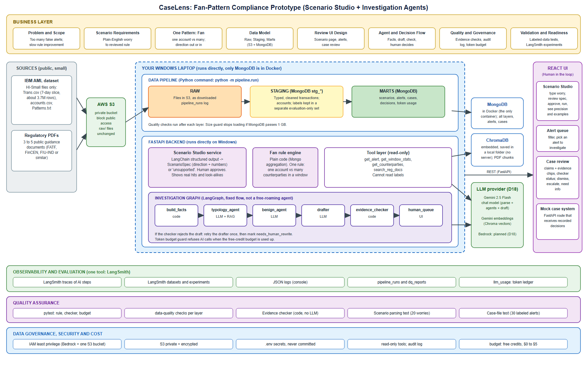

# CaseLens

A small financial-crime compliance prototype built around **one suspicious pattern**: the **fan pattern** — one account
paying many different accounts (fan-out) or receiving from many different accounts (fan-in) within a time window.

> **Prototype on simulated public data. Not a compliance system.** The AI only drafts; a human decides.



## 1. What and why

Banks run rules that raise money-laundering alerts. Two things hurt:

1. **Most alerts are false alarms**, yet an analyst must collect facts and write a case file for each one.
2. **Improving a rule is slow**, because the risk owner, the analyst and the model team keep re-explaining it to each other.

CaseLens tries two small answers:

- **Scenario Studio** — a risk owner writes a worry in plain English. An LLM turns it into a closed, validated
  `ScenarioSpec` (direction plus two numbers) or rejects it as unsupported. A human approves it; the rule runs on
  labeled data and shows precision, pattern recall, and real hits and look-alikes.
- **Investigation agents** — for one alert, code builds a fact sheet; two helpers add regulator guidance and possible
  harmless explanations; a drafter writes a case file in which every claim cites fact ids or document excerpts; a
  plain-code checker rejects unsupported numbers and ids (one retry); a human reviews and decides.

The quality goal is a **false-clear rate of zero**: a really suspicious alert must never be marked likely legitimate.

## 2. Honest scope

- **Data:** IBM's *HI-Small* AML dataset, which IBM **simulated** from a virtual world, and only the first
  `SLICE_HOURS` of it. Three public regulator documents for context. No real customer data.
- **One pattern only.** Worries about cash structuring, cycles, countries, risk scores or single large payments are
  rejected as unsupported on purpose.
- **Fixed time windows** counted from the start of the data (not rolling windows), so a burst that straddles a window
  boundary can be split in two. A window is evaluated only once it is complete, so the newest partial window waits
  for the next upload.
- **New data arrives by upload, not a live feed** (M7). Upload a CSV in the IBM transaction format on the Data page;
  rows already loaded are skipped, and approved scenarios can then run on the new windows only.
- **The checker verifies support, not judgement.** It confirms that each number and id in a claim appears in the cited
  facts. It cannot tell whether a claim is reasonable, and numbers written as words are not checked (the prompts ask
  for digits).
- **Demo sign-in, not production identity.** Two predefined accounts (risk owner, analyst) with server-side role checks;
  no user management, password reset or deployment. **No compliance claims.**

## 3. Architecture and flow

```
IBM HI-Small (2 files) ─┐                         ┌─ Scenario Studio ── fan rule (Mongo aggregation) ── metrics
Regulator PDFs (3) ─────┴─► S3 raw/ ─► pipeline ─► MongoDB stg_* ─┤
                                         └─► Chroma (embedded)     └─ Investigation graph (LangGraph)
                                                                       build_facts (code)
                                                                       ├─ typology_agent (LLM + Chroma)
                                                                       └─ benign_agent (LLM)
                                                                       drafter (LLM) → evidence_checker (code)
                                                                       → one retry → human decision (React)
```

- Only **MongoDB runs in Docker**; FastAPI, the pipeline and React run on Windows. Chroma is embedded (`data/chroma`).
- **Model provider behind one switch** (`LLM_PROVIDER`, decision D18). Measured with **Google Gemini 3.5 Flash-Lite** and
  **Gemini embeddings** (free API tier). **Amazon Bedrock** (Qwen3 Next 80B plus Titan Text Embeddings v2 in `ap-south-1`)
  is implemented as the production path but not yet measured: the AWS account's Bedrock access was still pending.
- AWS: **S3 and IAM** for raw data; Bedrock when enabled.
- **LangSmith** is the only tracing and evaluation tool; everything also works with `LANGSMITH_TRACING=false`.

## 4. How to run (Windows, PowerShell)

Prerequisites: Git, Python 3.12, Node.js LTS, AWS CLI v2, Docker Desktop (WSL2). Details in `PROJECT_REPORT.md` §7.

```powershell
git clone <repo> caseLens; cd caseLens
Copy-Item .env.example .env          # fill in GEMINI_API_KEY, AWS_PROFILE, S3_BUCKET, LANGSMITH_API_KEY
& "$env:LocalAppData\Programs\Python\Python312\python.exe" -m venv .venv
.\.venv\Scripts\Activate.ps1
pip install --no-cache-dir -e "backend[dev]"
docker compose up -d mongo

cd backend
pytest -q                            # unit tests (no network)
pytest -q -m integration             # needs the MongoDB container
python -m app.scripts.smoke          # one chat reply, one structured output, one embedding (a few hundred tokens)

# data (download the two HI-Small files into data\ibm and the PDFs listed in docs\SOURCES.yaml into data\reg_docs)
python -m pipeline.slice_advice      # choose SLICE_HOURS
python -m pipeline.run --step all    # raw -> staging -> labels -> docs -> dq
python -m pipeline.disk_report

uvicorn app.main:app --port 8000     # API (set CORS_ORIGINS / API_BASE_URL in .env if you change ports)
```

```powershell
cd frontend
npm install
npm run dev                          # http://localhost:5173 (set VITE_API_BASE if the API is not on :8000)
```

Command-line tools (all AI spending is estimated first and refused if over budget):

| Command | Purpose |
|---|---|
| `python -m app.eval.run_scenario_eval --dry-run` / `--yes` | Eval set 1: 20 worries |
| `python -m app.scripts.investigate --scenario-id <id> --n 5` | Investigate a few alerts from the command line |
| `python -m app.scripts.make_dev_split --scenario-id <id>` | Build the 10 dev + 30 eval alerts |
| `python -m app.eval.run_case_eval --split dev --tune` | Prompt work and baseline tuning (dev only) |
| `python -m app.eval.run_case_eval --split eval --reuse` | Final comparison of systems A, B, C |
| `python -m app.scripts.estimate_cost --price-in X --price-out Y` | Spend so far from the token ledger |

### Adding new data (M7)

1. **Data** page → drop a CSV (IBM transaction format, optional IBM patterns file) → **Upload and check**. The
   validation report shows rows read, rows to add, rows already loaded, and rejected rows with reasons. Nothing is
   saved yet.
2. **Add rows to the data** → rows are appended (the original file goes to S3 `raw/uploads/` when a bucket is set).
3. **Run approved scenarios on new data** → new alerts appear in the Alert queue; old alerts are never duplicated.
4. On a scenario page, **Run again → Date range** lets a rule designed on one period be checked on another
   (for example, design on day 1, validate on day 2) and compared in the run history.

An honest demo with no invented data: load day 1 of HI-Small with the pipeline, then upload later days of the same
file as "new" data.

## 5. Data sources and licenses

See `docs/SOURCES.md` (IBM AML: CDLA-Sharing-1.0; regulator documents under their publishers' terms) and
`docs/DATA_NOTES.md` for what was verified on the real files.

## 6. Design decisions

- **Code collects the facts; the LLM only fills schemas.** Every number in a case file comes from the fact sheet
  (F0–F10). The LLM never writes queries or code and never sees raw transaction rows.
- **A checker instead of trust.** A plain-code checker verifies every claim's ids and numbers; one retry, then the case
  goes to a human as "write it yourself".
- **Labels are hidden from the AI.** Ground truth lives only in `stg_labels`, `stg_pattern_blocks` and `alert_truth`.
  The tools have an allow-list that excludes them, responses strip truth keys, and leakage tests check tool outputs,
  every prompt, and every case document.
- **The LLM for two jobs only:** filling a scenario spec and writing case files. One small model, temperature 0,
  capped output, a per-case call limit and a **hard token budget in code** that persists across restarts and refuses
  calls when used up.
- **A human decides.** Decisions are `dismiss`, `escalate` or `need_info`, append-only, with a required reason, and
  are forwarded to a mock downstream case system.

## 7. Results

**Not measured yet.** The pipeline, rule, Scenario Studio, investigation graph and UI are built and tested with fake
models (118 automated tests). The data is loaded (168-hour slice) and verified (`docs/DATA_NOTES.md`); the AI runs are
next. This section will
hold only measured numbers:

- Scenario metrics (alert count, precision, pattern recall) for fan-out and fan-in on the chosen slice.
- Eval set 1 (20 worries): schema validity, direction match, parameters in expectation, correct rejection.
- Eval set 2 (results table below), produced by `run_case_eval` into `docs/results/`.

| System | n | False-clear | Auto-clear | Review load | Checker after-retry | Avg latency | Avg tokens |
|---|---|---|---|---|---|---|---|
| A. Rule only | | | | | | | |
| B. Code baseline (CV_MAX=…, REPEAT_MIN=…) | | | | | | | |
| C. CaseLens (Gemini 3.5 Flash-Lite, prompt v1) | | | | | | | |

**Failures:** 3 to 5 concrete cases (what the system said, what was true, why, what changed) — to be written after
the runs. **Limits:** see §2.

## 8. Cost and cleanup

- Budget: Gemini free tier now (no card); for Bedrock, $0–5 of free credits. Defaults: 1.5 M input / 0.3 M output chat tokens, 0.4 M embedding tokens,
  6 AI calls per case. Spend so far: `python -m app.scripts.estimate_cost` (look up current prices yourself).
- Disk: project artifacts under 10 GB (`python -m pipeline.disk_report`).
- Cleanup: `docker compose down -v` (deletes the MongoDB volume); delete `data\`; delete the S3 objects and bucket;
  remove the IAM user's access keys; delete the LangSmith project if wanted.

## 9. What I would do next

Rolling windows, more patterns (each with its own facts and tests), a second model as an independent judge for
faithfulness spot-checks, and an evaluation on more than 30 alerts once the free-credit budget allows.
